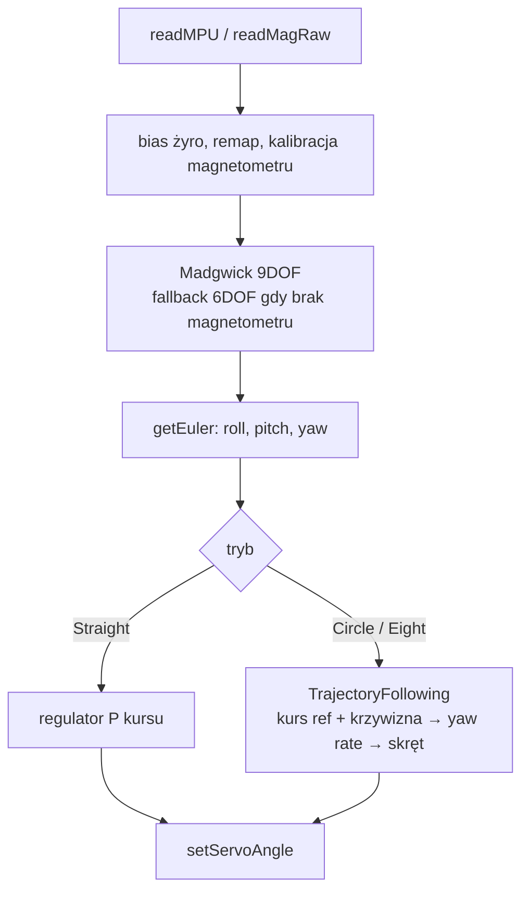

# Lemniscate Car – ESP32, filtr Madgwicka 9DOF i jazda po ósemce

Szkic Arduino dla ESP32, który:

1. odczytuje IMU **MPU6050** i magnetometr **QMC5883P** (moduł typu GY‑87) przez I²C,
2. estymuje orientację (roll / pitch / yaw) własną implementacją **filtru Madgwicka 9DOF**,
3. steruje serwem skrętu tak, aby pojazd jechał po **lemniskacie Bernoulliego (ósemce)**, po okręgu albo prosto na zadany kurs.

Regulator jest kaskadowy (kurs → prędkość kątowa → skręt serwa) z feedforwardem z krzywizny ścieżki i z geometrii kierownicy (model rowerowy).

> **Ważne:** pojazd nie ma pomiaru położenia (enkodera, GPS), tylko kurs i prędkość kątową. Regulator prowadzi go po *kształcie* ścieżki, ale pozycja będzie dryfować (patrz [Ograniczenia](#ograniczenia)).

## Spis treści

- [Struktura repozytorium](#struktura-repozytorium)
- [Sprzęt i połączenia](#sprzęt-i-połączenia)
- [Szybki start](#szybki-start)
- [Architektura](#architektura)
- [Matematyka](#matematyka)
  - [1. Konwencje](#1-konwencje)
  - [2. Przetwarzanie czujników](#2-przetwarzanie-czujników)
  - [3. Filtr Madgwicka 9DOF](#3-filtr-madgwicka-9dof)
  - [4. Ścieżki: lemniskata i okrąg](#4-ścieżki-lemniskata-i-okrąg)
  - [5. Regulator trajektorii](#5-regulator-trajektorii)
  - [6. Tryb Straight](#6-tryb-straight)
  - [7. Dobór parametrów i ograniczenia fizyczne](#7-dobór-parametrów-i-ograniczenia-fizyczne)
- [Parametry konfiguracyjne](#parametry-konfiguracyjne)
- [Strojenie krok po kroku](#strojenie-krok-po-kroku)
- [Ograniczenia](#ograniczenia)
- [Weryfikacja](#weryfikacja)

---

## Struktura repozytorium

```
lemniscate_car/
├── lemniscate_car.ino         # czujniki, kalibracje, Madgwick, tryby jazdy, serwo
├── TrajectoryFollowing.h      # interfejs modułu trajektorii
├── TrajectoryFollowing.cpp    # generator ścieżek i regulator kaskadowy
└── README.md
```

Szkic Arduino musi leżeć w folderze o takiej samej nazwie jak plik `.ino`.

## Sprzęt i połączenia

| Element | Szczegóły |
|---|---|
| Mikrokontroler | ESP32 (biblioteka `ESP32Servo`) |
| IMU | MPU6050, adres I²C `0x68` |
| Magnetometr | QMC5883P, adres I²C `0x2C`, widoczny na magistrali dzięki trybowi **BYPASS** MPU6050 |
| I²C | SDA = GPIO 14, SCL = GPIO 15, 400 kHz |
| Serwo skrętu | GPIO 12, impulsy 1000–2000 µs (0–180°) |

Konfiguracja czujników w `setup()`: żyroskop ±500 °/s, akcelerometr ±2 g, próbkowanie 200 Hz, DLPF ≈ 44 Hz.

## Szybki start

1. Zainstaluj w Arduino IDE obsługę płytek ESP32 i bibliotekę **ESP32Servo**.
2. Wgraj szkic. Podczas startu **nie ruszaj pojazdem** (ok. 1,5 s kalibracji biasu żyroskopu).
3. Po ok. 3 s (zbieżność filtru) pojazd uzbraja się i wchodzi w `START_MODE` (domyślnie `Straight`).
4. Komendy w Serial Monitorze (115200 baud):

| Komenda | Tryb | Działanie |
|---|---|---|
| `0` | Idle | serwo na środku |
| `s` | Straight | utrzymanie kursu z chwili włączenia |
| `c` | Circle | okrąg przeciwnie do ruchu wskazówek zegara |
| `e` | Eight | ósemka (lemniskata) |

Każdy tryb startuje od **aktualnego kursu pojazdu** – ścieżka jest obracana tak, żeby zaczynała się tam, gdzie stoi auto.

5. Telemetria (co 100 ms):
   `M` – tryb, `R/P/Y` – roll/pitch/yaw [°], `MAG` – ważność magnetometru, `href` – kurs zadany [°], `herr` – błąd kursu [°], `k` – krzywizna [1/m], `servo` – komenda serwa [°].

### Kalibracja magnetometru

Ustaw `MAG_CAL_AT_BOOT 1`, wgraj i przez 20 s obracaj czujnik we wszystkich osiach (ósemki w powietrzu). Skopiuj z Serial Monitora wypisane `magOffset` i `magScale` do kodu i wróć do `MAG_CAL_AT_BOOT 0`. Kalibruj **na zmontowanym pojeździe** (silnik i serwo zniekształcają pole). Do sprawdzenia mapowania osi służy `DEBUG_MAG_AXES 1`.

## Architektura



Kolejność w pętli (100 Hz) jest istotna: **filtr → kąty Eulera → regulator**, więc regulator zawsze dostaje świeży `yaw`. Filtr i regulator używają tego samego, zmierzonego `dt`.

---

## Matematyka

### 1. Konwencje

- Układ ciała: prawoskrętny, **oś Z w górę**. Dodatni `yaw` i `gz` oznaczają obrót w lewo (przeciwnie do ruchu wskazówek zegara).
- `yaw = 0`, gdy oś X czujnika wskazuje północ magnetyczną (bez poprawki na deklinację).
- Krzywizna $\kappa > 0$ oznacza skręt w lewo.
- Kąty w regulatorze trajektorii są liczone w radianach i zawijane do $(-\pi, \pi]$:

$$\mathrm{wrap}(\alpha) = \alpha - 2\pi \cdot \mathrm{round}\!\left(\frac{\alpha}{2\pi}\right)$$

(w kodzie zrealizowane pętlą `while`).

### 2. Przetwarzanie czujników

**Skalowanie surowych odczytów** (liczby 16‑bitowe ze znakiem):

$$a = \frac{\mathrm{raw}_a}{16384}\ [\mathrm{g}], \qquad \omega = \frac{\mathrm{raw}_\omega}{65{,}5}\ [^\circ/\mathrm{s}]$$

**Bias żyroskopu** – średnia z $N = 500$ próbek w spoczynku, odejmowana od każdego pomiaru:

$$\mathbf{b}_g = \frac{1}{N}\sum_{k=1}^{N}\boldsymbol{\omega}_k, \qquad \boldsymbol{\omega} \leftarrow \boldsymbol{\omega} - \mathbf{b}_g$$

**Mapowanie osi magnetometru** na układ MPU6050 (obrót, $\det R = +1$, więc układ pozostaje prawoskrętny):

$$\mathbf{m}' = R\,\mathbf{m}_{raw}, \qquad R = \begin{bmatrix}0&-1&0\\-1&0&0\\0&0&-1\end{bmatrix}$$

**Kalibracja magnetometru** (hard‑iron + uproszczony soft‑iron) z minimów i maksimów $m_i^{min}, m_i^{max}$ zebranych podczas obracania czujnika:

$$o_i = \frac{m_i^{max}+m_i^{min}}{2}, \qquad r_i = \frac{m_i^{max}-m_i^{min}}{2}, \qquad \bar r = \frac{1}{3}\sum_i r_i, \qquad s_i = \frac{\bar r}{r_i}$$

$$m_i = s_i\,(m_i' - o_i)$$

Soft‑iron jest tu tylko skalowaniem osi (macierz diagonalna), bez wyrazów pozadiagonalnych. W idealnym przypadku punkty pomiarowe leżą na sferze o stałym promieniu.

### 3. Filtr Madgwicka 9DOF

Orientację opisuje kwaternion jednostkowy $q = [q_0, q_1, q_2, q_3]$, który obraca układ Ziemi w układ czujnika.

**Kinematyka z żyroskopu** ($\boldsymbol\omega$ w rad/s):

$$\dot q_\omega = \tfrac12\, q \otimes [0,\ \omega_x,\ \omega_y,\ \omega_z]$$

czyli składowo (jak w kodzie):

$$\dot q_\omega = \tfrac12\begin{bmatrix}-q_1\omega_x - q_2\omega_y - q_3\omega_z\\ q_0\omega_x + q_2\omega_z - q_3\omega_y\\ q_0\omega_y - q_1\omega_z + q_3\omega_x\\ q_0\omega_z + q_1\omega_y - q_2\omega_x\end{bmatrix}$$

**Korekta z akcelerometru i magnetometru.** Wektory $\hat{\mathbf a}$ i $\hat{\mathbf m}$ są normalizowane. Funkcja błędu $f(q)$ to różnica między kierunkami *przewidywanymi* z orientacji $q$ a zmierzonymi.

Grawitacja (w Ziemi: $[0,0,1]$):

$$f_g = \begin{bmatrix} 2(q_1q_3 - q_0q_2) - a_x \\ 2(q_0q_1 + q_2q_3) - a_y \\ 2\left(\tfrac12 - q_1^2 - q_2^2\right) - a_z \end{bmatrix}$$

Pole magnetyczne. Najpierw pomiar jest obracany do układu Ziemi, $h = q \otimes [0,\hat{\mathbf m}] \otimes q^{*}$, a następnie wyznaczany jest **kierunek odniesienia** pola, leżący w płaszczyźnie X–Z Ziemi (Y ma wskazywać wschód):

$$b_x = \sqrt{h_x^2 + h_y^2}, \qquad b_z = h_z$$

$$f_m = \begin{bmatrix} 2b_x\left(\tfrac12 - q_2^2 - q_3^2\right) + 2b_z(q_1q_3 - q_0q_2) - m_x \\ 2b_x(q_1q_2 - q_0q_3) + 2b_z(q_0q_1 + q_2q_3) - m_y \\ 2b_x(q_0q_2 + q_1q_3) + 2b_z\left(\tfrac12 - q_1^2 - q_2^2\right) - m_z \end{bmatrix}$$

Dzięki takiej konstrukcji magnetometr koryguje **tylko yaw** (nachylenie pola – inklinacja – jest wchłonięte w $b_z$), a pochylenie wyznacza grawitacja.

**Krok gradientowy.** Dla $f = [f_g;\ f_m]$ (6 równań, 4 niewiadome):

$$\nabla f = J^{T} f, \qquad \dot q = \dot q_\omega - \beta\,\frac{\nabla f}{\lVert\nabla f\rVert}$$

$$q_{k+1} = \frac{q_k + \dot q\,\Delta t}{\lVert q_k + \dot q\,\Delta t\rVert}$$

Parametr $\beta$ to „zaufanie” do akcelerometru i magnetometru względem żyroskopu: duże $\beta$ → szybka zbieżność, ale większy szum; małe → gładko, ale wolna korekcja dryfu żyroskopu. W kodzie $\beta = 1{,}0$ przez pierwsze 3 s (szybka zbieżność po starcie), potem $\beta = 0{,}1$.

> **Uwaga o implementacji.** W kodzie zmienne `_2bx` i `_2bz` muszą równać się $2b_x$ i $2b_z$, bo tak zapisano funkcję $f_m$ i jakobian $J$. W oryginalnym kodzie referencyjnym brakowało tego czynnika 2, więc błąd magnetometru nie zerował się w prawdziwej orientacji i wprowadzał stałe obciążenie estymaty. Sprawdzono to numerycznie: przy poprawnym $q$ i spójnych pomiarach norma gradientu wynosi $\approx 0{,}018$ dla wersji oryginalnej i $0$ po poprawce. Ta repozytoryjna wersja zawiera poprawkę.

**Wariant 6DOF.** Gdy magnetometr nie odpowiada dłużej niż 200 ms (`MAG_TIMEOUT_MS`), używany jest tylko $f_g$. Wtedy yaw nie ma odniesienia i dryfuje razem z biasem żyroskopu.

**Kąty Eulera** (sekwencja Z‑Y‑X):

$$\phi = \mathrm{atan2}\!\big(2(q_0q_1 + q_2q_3),\ 1 - 2(q_1^2 + q_2^2)\big)$$

$$\theta = \arcsin\!\big(\mathrm{clamp}_{[-1,1]}\,2(q_0q_2 - q_3q_1)\big)$$

$$\psi = \mathrm{atan2}\!\big(2(q_0q_3 + q_1q_2),\ 1 - 2(q_2^2 + q_3^2)\big)$$

Argument `asin` jest obcinany do $[-1, 1]$. Przy $\theta \to \pm 90^\circ$ występuje osobliwość kątów Eulera (gimbal lock); dla pojazdu naziemnego nie jest to problem.

### 4. Ścieżki: lemniskata i okrąg

#### Lemniskata Bernoulliego

Parametryzacja z parametrem $t$ i rozmiarem $a$ (`scale`):

$$x(t) = \frac{a\cos t}{1 + \sin^2 t}, \qquad y(t) = \frac{a\sin t\cos t}{1 + \sin^2 t}$$

Wymiary: szerokość $2a$, wysokość $\approx 0{,}707\,a$, długość pełnej pętli $L \approx 5{,}244\,a$.

**Pierwsze pochodne** (analityczne, regułą ilorazu; $D = 1 + \sin^2 t$):

$$\dot x = \frac{-a\sin t\,(3 - \sin^2 t)}{D^2}, \qquad \dot y = \frac{a\,(1 - 3\sin^2 t)}{D^2}$$

**Drugie pochodne** są liczone różnicą centralną *z pochodnej analitycznej*:

$$\ddot x \approx \frac{\dot x(t+h) - \dot x(t-h)}{2h}, \qquad \ddot y \approx \frac{\dot y(t+h) - \dot y(t-h)}{2h}, \qquad h = 0{,}01$$

Dlaczego nie różnica drugiego rzędu z położenia? Wzór $(x_+ - 2x_0 + x_-)/h^2$ dzieli błąd zaokrągleń `float` ($\sim 10^{-7}$) przez $h^2 = 10^{-6}$, czyli daje szum rzędu $0{,}1$ – porównywalny z sygnałem. Różnica z pochodnej dzieli ten błąd tylko przez $2h$, więc szum jest mały (rzędu $10^{-5}$).

**Kurs, krzywizna i prędkość po parametrze:**

$$\psi_{path}(t) = \mathrm{atan2}(\dot y,\ \dot x), \qquad \kappa(t) = \frac{\dot x\,\ddot y - \dot y\,\ddot x}{\left(\dot x^2 + \dot y^2\right)^{3/2}}, \qquad \lVert\dot{\mathbf r}\rVert = \sqrt{\dot x^2 + \dot y^2}$$

Własności lemniskaty:

- krzywizna jest największa na „czubkach” ósemki: $|\kappa|_{max} = \dfrac{3}{a}$ (najmniejszy promień $a/3$),
- w punkcie przecięcia ($t = \pi/2$ i $t = 3\pi/2$) krzywizna wynosi $0$, a ścieżki przecinają się pod kątem $90^\circ$ (kursy $-135^\circ$ i $-45^\circ$ w układzie ścieżki).

**Ruch punktu odniesienia ze stałą prędkością liniową.** Z warunku $ds = \lVert\dot{\mathbf r}\rVert\,dt = v\,d\tau$ wynika

$$\dot t = g\,\frac{v}{\lVert\dot{\mathbf r}\rVert}$$

gdzie $v$ to `vehicleSpeed`, a $g \in [0,1]$ to bramka opisana w [sekcji 5](#5-regulator-trajektorii). Pełna pętla trwa $T = L/v$ (dla $a = 3$ m i $v = 1$ m/s ok. 15,7 s). Parametr jest zawijany: $t \leftarrow t - 2\pi$, gdy $t \ge 2\pi$.

**Start od przecięcia i dopasowanie do kursu pojazdu.** Ścieżka startuje w $t_0 = \pi/2$ (krzywizna 0, łagodny początek) i jest obracana o stałą $\Delta$ tak, aby kurs ścieżki w punkcie startu równał się kursowi pojazdu $\psi_{start}$:

$$\Delta = \mathrm{wrap}\big(\psi_{start} - \psi_{path}(t_0)\big), \qquad \psi_{ref}(t) = \mathrm{wrap}\big(\psi_{path}(t) + \Delta\big)$$

Krzywizna nie zależy od obrotu.

#### Okrąg

$$x = R\cos t,\quad y = R\sin t,\qquad \psi_{path} = t + \tfrac{\pi}{2},\qquad \kappa = \tfrac{1}{R},\qquad \lVert\dot{\mathbf r}\rVert = R,\qquad \dot t = g\,\tfrac{v}{R}$$

Start w $t_0 = 0$, obrót $\Delta$ liczony jak wyżej. Okrąg jest przejeżdżany zawsze przeciwnie do ruchu wskazówek zegara.

### 5. Regulator trajektorii

Wejścia: kurs $\psi$ [°] z filtru i prędkość kątowa $\omega = g_z$ [rad/s] z żyroskopu (po odjęciu biasu). Wyjście: komenda serwa.

**1) Błąd kursu**

$$e_\psi = \mathrm{wrap}\big(\psi_{ref} - \psi\big)$$

**2) Zadana prędkość kątowa** – feedforward z krzywizny plus korekta kursu:

$$\omega_{des} = v\,\kappa + K_\psi\, e_\psi, \qquad e_\omega = \omega_{des} - \omega$$

Człon $v\kappa$ jest dokładnie prędkością zmiany kursu ścieżki ($\dot\psi_{path} = \kappa\,\dot s = \kappa v$).

**3) Skręt z modelu rowerowego.** Dla pojazdu o rozstawie osi $L$ i kącie skrętu kół $\delta$:

$$\omega = \frac{v}{L}\tan\delta \quad\Longrightarrow\quad \delta_{ff} = \arctan\!\left(L\,\frac{\omega_{des}}{v}\right)$$

Sterowanie serwa (w stopniach, $k_s$ – stopnie serwa na stopień skrętu kół, $\sigma = \pm 1$ – znak montażu):

$$u = \mathrm{clamp}\Big(k_s\,\delta_{ff}[^\circ] + K_\omega\, e_\omega,\ -\Delta_{max},\ \Delta_{max}\Big)$$

$$\mathrm{servo} = \mathrm{servo}_{center} + \sigma\,u$$

Feedforward $\delta_{ff}$ niesie główną część sterowania, a $K_\omega e_\omega$ koryguje niedokładność modelu. Gdy `wheelbase = 0`, feedforward jest wyłączony i regulator działa jak zwykły P na prędkości kątowej (ze stałym uchybem w zakrętach).

**4) Dynamika błędu kursu.** Jeżeli pętla wewnętrzna jest dość szybka ($\omega \approx \omega_{des}$), to

$$\dot e_\psi = \dot\psi_{ref} - \omega = v\kappa - \big(v\kappa + K_\psi e_\psi\big) = -K_\psi\, e_\psi$$

czyli błąd kursu zanika wykładniczo ze stałą czasu $\tau = 1/K_\psi$ (dla $K_\psi = 0{,}5\ \mathrm{s}^{-1}$: 2 s).

**5) Bramka punktu odniesienia.** Aby referencja nie uciekała pojazdowi, gdy ten nie nadąża, parametr $t$ zwalnia, kiedy pojazd jest *za* referencją w zakręcie:

$$\ell = \mathrm{sign}(\kappa)\,e_\psi, \qquad g = \mathrm{clamp}\!\left(1 - \frac{\ell}{\varepsilon},\ 0,\ 1\right), \quad \varepsilon = 60^\circ$$

Bramka działa tylko dla $|\kappa| > 0{,}05\ \mathrm{m^{-1}}$ (na prostych odcinkach pojęcie „za/przed” jest nieokreślone, wtedy $g = 1$). Gdy pojazd jest *przed* referencją ($\ell < 0$), $g = 1$, bo zwalnianie referencji jeszcze pogłębiałoby rozjazd.

### 6. Tryb Straight

Regulator P kursu z zawijaniem błędu do $\pm 180^\circ$ i ograniczeniem:

$$e = \mathrm{wrap}_{180}(\psi_{set} - \psi), \qquad u = \mathrm{clamp}\big(k_P\, e,\ -30^\circ,\ 30^\circ\big), \qquad \mathrm{servo} = 90^\circ + \sigma\,u$$

Zawijanie jest konieczne: bez niego przy $\psi = 170^\circ$ i $\psi_{set} = -100^\circ$ błąd wynosiłby $-270^\circ$ zamiast $+90^\circ$ i serwo skręcałoby w złą stronę.

### 7. Dobór parametrów i ograniczenia fizyczne

Przy zadanej ścieżce wymagania dla pojazdu wynikają bezpośrednio z krzywizny.

- **Skręt kół:** na czubku ósemki $\kappa_{max} = 3/a$, więc potrzebny kąt kół to $\delta_{max,req} = \arctan(3L/a)$. Musi się mieścić w zakresie serwa: $k_s\,\delta_{max,req} \le \Delta_{max}$. Dla $L = 0{,}3$ m i $a = 3$ m: $\arctan(0{,}3) = 16{,}7^\circ$.
- **Przyspieszenie boczne:** $a_y = v^2\kappa_{max} = 3v^2/a$. Dla $a = 3$ m i $v = 1$ m/s: $1\ \mathrm{m/s^2}$ ($\approx 0{,}1$ g). Dla $a = 2$ m i $v = 2$ m/s byłoby $6\ \mathrm{m/s^2}$ ($\approx 0{,}6$ g), czyli bardzo agresywnie dla modelu RC.
- **Wzmocnienie pętli prędkości kątowej:** po linearyzacji ($\delta$ w stopniach kół, $u = k_s \delta$) przyrost $\omega$ na jednostkę $e_\omega$ wynosi

$$G = K_\omega\cdot\frac{v}{L}\cdot\frac{\pi}{180}\cdot\frac{1}{k_s}$$

 Dla $K_\omega = 5$, $v = 1$ m/s, $L = 0{,}3$ m, $k_s = 1$: $G \approx 0{,}29$. To jest łagodna korekta; dokładność w zakrętach zapewnia feedforward. Zwiększając $K_\omega$ poprawiasz tłumienie zakłóceń, ale przy zbyt dużej wartości (z opóźnieniem serwa) pojawią się oscylacje.

---

## Parametry konfiguracyjne

| Parametr | Domyślnie | Znaczenie |
|---|---|---|
| `scale` ($a$) | 3,0 m | rozmiar ósemki (szerokość $2a$) |
| `circleRadius` ($R$) | 1,5 m | promień okręgu |
| `vehicleSpeed` ($v$) | 1,0 m/s | zakładana prędkość pojazdu (nie jest mierzona) |
| `K_heading` ($K_\psi$) | 0,5 1/s | wzmocnienie błędu kursu |
| `K_yawRate` ($K_\omega$) | 5,0 °/(rad/s) | wzmocnienie błędu prędkości kątowej |
| `wheelbase` ($L$) | 0,30 m | rozstaw osi (**ustaw własny**; 0 wyłącza feedforward) |
| `servoDegPerWheelDeg` ($k_s$) | 1,0 | przełożenie serwo → koła |
| `steerSign` ($\sigma$) | +1 | znak skrętu (`STEER_SIGN`) |
| `servoCenter` | 90° | środek serwa |
| `maxServoDeviation` ($\Delta_{max}$) | 30° | maksymalne wychylenie |
| `kP` (Straight) | 0,2 | wzmocnienie P kursu |
| `BETA_START` / `BETA_RUN` | 1,0 / 0,1 | $\beta$ filtru: pierwsze 3 s / potem |
| `LOOP_DT` | 0,01 s | okres pętli (100 Hz) |
| `MAG_TIMEOUT_MS` | 200 ms | po tym czasie bez próbki filtr przechodzi na 6DOF |

## Strojenie krok po kroku

1. **Bez napędu, na stole.** Sprawdź, że `yaw` rośnie przy obrocie w lewo i że po kalibracji magnetometr stabilizuje yaw (stan `MAG:OK`).
2. **Znak skrętu.** Komenda `c` powinna skręcać koła w lewo. Jeśli skręcają w prawo, zmień `STEER_SIGN` na `-1`.
3. **Rozstaw osi.** Wpisz rzeczywiste `wheelbase`. Zmierz maksymalny skręt kół i sprawdź warunek z sekcji 7.
4. **Okrąg przed ósemką.** Uruchom `c` na małej prędkości, obserwuj `herr`. Powinien być bliski zeru.
5. **Ósemka.** Zwiększaj `vehicleSpeed` stopniowo. Jeśli `servo` nasyca się na ±30°, zmniejsz $v$ lub zwiększ $a$.
6. **Kurs:** zwiększ `K_heading`, jeśli pojazd „spóźnia się” za ścieżką; zmniejsz, jeśli kołysze.

## Ograniczenia

- **Brak sprzężenia pozycyjnego.** Regulator zna tylko kurs i prędkość kątową. Punkt odniesienia porusza się po kształcie ścieżki ze stałą prędkością $v$ (ze spowolnieniem, gdy pojazd zostaje w zakręcie), ale rzeczywista pozycja nie jest mierzona, więc ósemka się przesuwa i skręca. Wymagany jest czujnik położenia (np. enkoder kół z dead‑reckoningiem, GPS, optyka), aby domknąć pętlę pozycyjną.
- **Prędkość zakładana.** $v$ jest parametrem, a nie pomiarem; jeśli rzeczywista prędkość jest inna, zmienia się też rzeczywista krzywizna toru i przyspieszenia.
- **Yaw magnetyczny.** Odniesieniem jest północ magnetyczna (bez deklinacji), a silnik i serwo zakłócają pole. Pomiar magnetometru może przekłamywać yaw w czasie jazdy; wtedy zmniejsz zaufanie do niego lub kalibruj na zmontowanym pojeździe.
- **Model rowerowy** pomija poślizg opon i dynamikę serwa.
- Okrąg jest realizowany tylko przeciwnie do ruchu wskazówek zegara.

## Weryfikacja

- **Regulator trajektorii** przetestowano na komputerze (kompilacja modułu `TrajectoryFollowing.cpp` i symulacja kinematycznego modelu rowerowego, $L = 0{,}3$ m, $v = 1$ m/s, start z kursem $-100^\circ$): na ósemce błąd kursu po ustaleniu ok. $0{,}1^\circ$, na okręgu ok. $0^\circ$.
- **Filtr Madgwicka:** funkcja błędu i gradient sprawdzone numerycznie w znanej orientacji (zerowy gradient przy spójnych pomiarach po poprawce czynnika 2).
- Szkic `.ino` nie był kompilowany ani uruchamiany na sprzęcie w ramach tych testów – wymaga sprawdzenia na docelowym ESP32.
